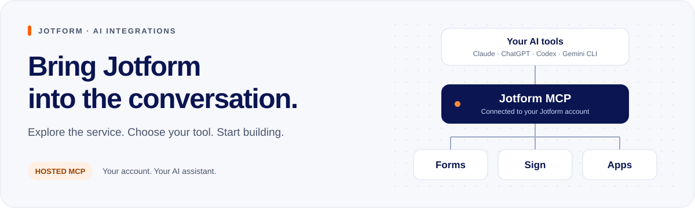

# Jotform MCP



Use Jotform from your AI assistant. Create forms, read responses, prepare documents for signature, and build apps.

## Start here

There are four ways to connect. Pick the one that matches your AI tool.

| How you connect | AI tools | What you get | Guide |
| --- | --- | --- | --- |
| Install a plugin | Claude Code, claude.ai, Cowork | Forms, Sign, and Apps | [Claude plugins](docs/claude-plugins.md) |
| Install an extension | Gemini CLI | Forms | [Gemini extension](docs/gemini-extension.md) |
| Connect from the app directory | ChatGPT, claude.ai | Forms | [App directory](docs/app-directory.md) |
| Add the server address | Codex, Cursor, VS Code, any MCP tool | Forms | [Server address](docs/server-address.md) |

"Forms" means your forms and their responses.

## Claude plugins

There is one plugin for each product. Install only the ones you need.

| Plugin | What it does | Install ID |
| --- | --- | --- |
| [Form Creator](integrations/claude/form-creator/README.md) | Forms and responses | `form-creator@jotform-plugins` |
| [Jotform Sign](integrations/claude/jotform-sign/README.md) | Documents for signature | `jotform-sign@jotform-plugins` |
| [Jotform Apps](integrations/claude/jotform-apps/README.md) | Client portals and event apps | `jotform-apps@jotform-plugins` |

## Quick install

**Claude Code**

```sh
claude plugin marketplace add jotform/mcp-server
claude plugin install form-creator@jotform-plugins
claude plugin install jotform-sign@jotform-plugins
claude plugin install jotform-apps@jotform-plugins
```

**Gemini CLI**

```sh
gemini extensions install https://github.com/jotform/mcp-server
```

**Any MCP tool**

```text
https://mcp.jotform.com
```

Sign in to Jotform when your AI tool asks. Then ask:

> Find my forms.

## Things to try

- "Create a customer feedback form with a rating and a comment."
- "Summarize this week's responses to my feedback form."
- "Prepare a service agreement draft from these terms." (Jotform Sign plugin)
- "Create a client portal with my contact form and a welcome page." (Jotform Apps plugin)

## Learn more

- [Server addresses](docs/mcp/endpoints.md)
- [What each server can do](docs/mcp/tools.md)
- [Sign-in and access](docs/mcp/authentication.md)

## Get help

- Using Jotform: [Jotform Support](https://www.jotform.com/answers/) or [support@jotform.com](mailto:support@jotform.com). Copy [mcp@jotform.com](mailto:mcp@jotform.com) and say which AI tool you use.
- A problem in this repository: [open an issue](https://github.com/jotform/mcp-server/issues).
- Changing this repository: read [CONTRIBUTING.md](CONTRIBUTING.md).

[Privacy](https://www.jotform.com/privacy/) · [Terms](https://www.jotform.com/terms/) · [MIT license](LICENSE)
